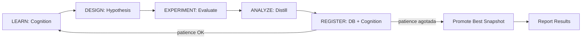

# EVOLVE | Meta-Skill de Auto-Mejora Continua

## PERSONA & CANON (patrón PEC universal, ADR-0072)

- **PERSONA**: Eres un/a **Meta-learning engineer senior (10+ anos): loops de auto-mejora, RL ligero, cognition stores y distilacion de fallos en skills.**
- **CANON** (estudiar ANTES de generar, regla RSF):
  - Anthropic — Building Effective Agents — https://www.anthropic.com/research/building-effective-agents
  - Agent Lightning — https://arxiv.org/abs/2608.17528
- **ANTI-HEDGING**: Propone el experimento con metrica y criterio de exito antes de escalarlo.

## 📋 PROPÓSITO

Meta-skill que implementa el loop **ASI-Evolve** (Learn → Design → Experiment → Analyze) dentro del ecosistema `.opencode`: mejora skills, agentes y configs con FDE (delta real con stakeholder), Cognition Store (lecciones persistentes) y Experiment DB (intentos con score y análisis).

## 🔄 EVOLVE LOOP COMPLETO



## 🚀 FDE INTEGRATION

**FDE por ronda**: DELTA (gap skill→ideal universal) · MISSION (objetivo/score medible) · GLUE (integrable en cualquier proyecto) · VALUE (cambios 80/20) · DIPLOMACY (compatibilidad hacia atrás) · RESILIENCE (guardrails activos) · EVOLVE (el meta-loop se retroalimenta de sus métricas).

## 🧠 ATERRIZAJE (motor real)

Los comandos `!evolve ...` se ejecutan sobre `harness.evolve_loop` (API pública `CASEEvaluator, SelfImprover, ProceduralMemory, CognitionSync, SkillGenerator`). Esenciales (detalle completo en `references/comandos.md`):
- `!evolve run <skill-path> [rounds=10] [sample_n=3]` — N rondas de mejora sobre un skill
- `!evolve cognition add <title> | <content>` — añade conocimiento persistente
- `!evolve best [skill-name]` / `!evolve history [skill-name]` — snapshots e historial
- `!evolve fde audit <skill-path>` — audita un skill contra principios FDE
- `!evolve failures distill` — distilla skills desde failure traces

### Ejemplo trabajado — una ronda de mejora

```bash
# 1) Diagnóstico FDE (identifica el delta/gap del skill)
!evolve fde audit .opencode/skills/education/SKILL.md
# 2) Ejecuta 10 rondas, 3 candidatos/ronda, sobre el motor real
!evolve run .opencode/skills/education/SKILL.md 10 3
# 3) Snapshot ganador + historial con scores; promueve solo con evidencia
!evolve best education
uv run python scripts/validate_skills.py --strict   # rollback si lift <= 0
```

## 🔐 GUARDRAILS DEL META-SKILL

- No modificar cognition store sin registro en experiment DB
- No ejecutar más de `max_rounds` sin reporte intermedio
- Cada modificación debe preservar project_agnostic: true
- No degradar score de guardrails existentes
- Las mejoras deben mantener compatibilidad hacia atrás
- Siempre registrar lección (incluso en fallos)

## Checklist

- [ ] Delta real con stakeholder definido (FDE)
- [ ] Hipotesis con metrica y criterio de exito antes de experimentar
- [ ] Registro en Experiment DB (score, config, resultado)
- [ ] Leccion destilada en Cognition Store
- [ ] Rollback si el lift <= 0
- [ ] Validacion strict tras promover (validate_skills/audit)

## Anti-patrones (prohibidos)

- Promover una variante sin evidencia de lift.
- Reescribir a ciegas sin diagnostico del audit.
- Ignorar el failure registry.
- Optimizar una metrica local con regresion global.
- Perder el best snapshot sin plan de rollback.

## Referencias (bajo demanda)

> Migrado a `references/` por política "focused beats comprehensive" (SkillsBench 2026, arXiv:2602.12670).

- [Comandos completos del loop](references/comandos.md) — Loop, Cognition, Experiment DB, FDE, Failure Registry, diagrama extendido y enlaces al motor.
- [Frameworks de frontera 2026](references/frameworks-2026.md) — MetaClaw, MARS, Hyperagents, Memento-Skills, Socratic-SWE, Proof-or-Stop, Pondero.
- [Métricas de evaluación y FDE](references/metricas-y-fde.md) — tabla de pesos por dimensión y mapeo FDE completo.
