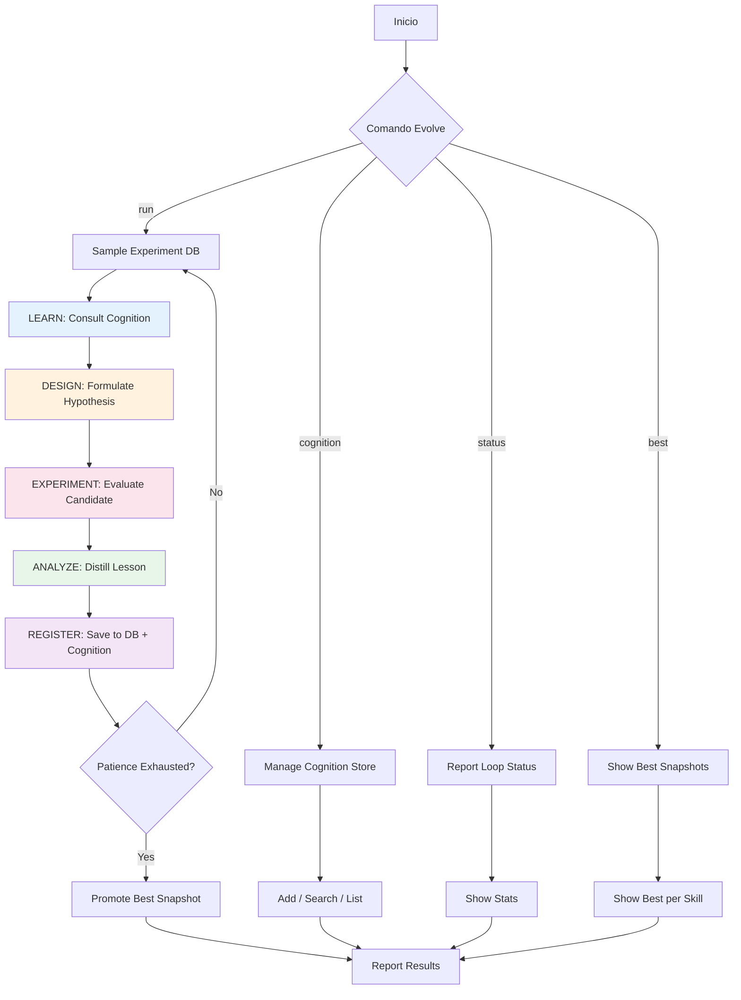

# Comandos del Loop Evolve — detalle bajo demanda

> Migrado de `SKILL.md` a `references/` por política "focused beats comprehensive"
> (SkillsBench 2026, arXiv:2602.12670). El aterrizaje sobre el motor real
> (`harness.evolve_loop`) permanece en `SKILL.md`; aquí vive el detalle de comandos.

> **Aterrizaje (motor real)**: los comandos `!evolve ...` se ejecutan sobre el módulo
> `harness.evolve_loop` (importar la API pública: `from harness.evolve_loop import CASEEvaluator, SelfImprover, ProceduralMemory, CognitionSync, SkillGenerator`).

### Gestión del Loop
- `!evolve run <skill-path> [rounds=10] [sample_n=3]` — Ejecuta N rondas de mejora sobre un skill
- `!evolve run all [rounds=5]` — Mejora todos los skills secuencialmente
- `!evolve status` — Muestra estado actual del loop
- `!evolve stats` — Estadísticas detalladas
- `!evolve stop` — Detiene el loop actual

### Cognition Store
- `!evolve cognition add <title> | <content>` — Añade conocimiento
- `!evolve cognition search <query>` — Busca en cognition
- `!evolve cognition list [tag]` — Lista items de cognition
- `!evolve cognition seed <skill-path>` — Siembra cognition desde un skill

### Experiment DB
- `!evolve best [skill-name]` — Mejor snapshot
- `!evolve history [skill-name]` — Historial de experimentos
- `!evolve compare <id1> <id2>` — Compara dos experimentos

### FDE
- `!evolve fde audit <skill-path>` — Audita un skill contra principios FDE
- `!evolve fde report` — Reporte FDE de todo el sistema

### Failure Registry (Socratic-SWE)
- `!evolve failures recent [n=10]` — Fallos más recientes
- `!evolve failures stats` — Métricas agregadas (by_type, by_severity)
- `!evolve failures unresolved` — Fallos pendientes de resolver
- `!evolve failures skills` — Skills derivados de fallos (deduplicados)
- `!evolve failures distill` — Distilla skills desde failure traces (CLI real: `uv run python scripts/distill_failures.py`; traces→skills→tasks)

## 🔄 Loop completo (diagrama extendido)

## 🔗 ENLACES

- 🔄 Loop Engine: `harness/evolve_loop/` — API pública `harness.evolve_loop` (CASEEvaluator, FullEvaluation, SelfImprover, ProceduralMemory, CognitionSync, SkillGenerator, GEPAMutator, PromptEvolver, AgentBuilder, AgentPruner, run_agent_evolution)
- 🧠 Cognition Store: `harness/db/lancedb/asi_cognition_store.lance` (vía `CognitionSync` / `CognitionLesson`)
- 📊 Experiment DB / Failure Registry: `harness/failure_registry/registry.py` (`FailureRegistry` -> `harness/db/failures.jsonl`)
- 🚀 FDE Principles: `.opencode/core/fde_principles.md`
- 📋 Base Principles: `.opencode/core/base_principles.md`
- ⚙️ Loop Config: variables del frontmatter (`EVOLVE_LOOP_DIR`, `EVOLVE_MAX_ROUNDS`, `EVOLVE_SAMPLE_N`, `EVOLVE_PATIENCE`)
- 🧪 Tests del motor: `harness/tests/test_evolve_skills.py`
