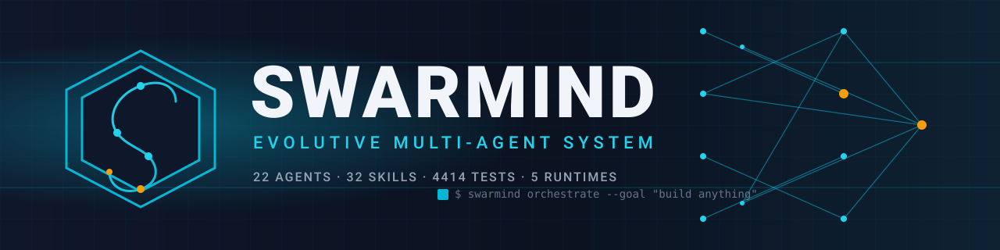
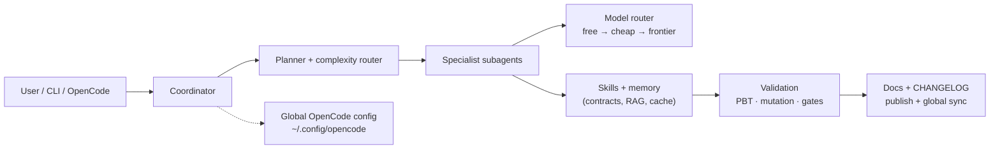

# Swarmind Multi-Agent Harness



[](https://github.com/MauricioFCC/SWARMIND/actions/workflows/ci.yml)
[](pyproject.toml)
[](harness/tests/)
[](LICENSE)
[](https://github.com/astral-sh/ruff)

**A Python harness for coordinating AI coding agents (OpenCode, Claude Code,
Codex) with one modular engine:** governed multi-agent fan-out, model routing,
portable memory, token economics, and validation that produces evidence instead
of claims.

- **For builders of agent systems** who need orchestration without a framework
  lock-in.
- **For research and engineering teams** that want TDD/adversarial validation,
  traceable decisions, and a clean separation between model, harness and tools.
- **For operators** who value reproducibility: one command sets up the harness
  and propagates it only to the global OpenCode config.

> Spanish is the primary documentation language (the README is in English for
> GitHub). Start at [`docs/README.md`](docs/README.md) or
> [`docs/src/es/README.md`](docs/src/es/README.md).

## At a glance

| | |
|---|---|
| **Agents** | 26 agents (specialist subagents) + coordinator (`.opencode/agents/`) |
| **Skills** | 49 skills reusable with contracts, `SKILL.min.md` and digests |
| **Engine** | Python 3.12+, hexagonal, `harness/` packages by domain |
| **Validation** | TDD, property-based tests, mutation oracles, architecture ratchets |
| **Memory** | LanceDB (optional) + SQLite-vec + federated search |
| **Platforms** | Windows, Linux, macOS; OpenCode global as the only propagated copy |
| **License** | MIT |

## Quickstart

```bash
git clone https://github.com/MauricioFCC/SWARMIND.git
cd SWARMIND

# 1. One-command setup: Python >=3.12, uv, dependencies, global OpenCode sync,
#    git hooks and import check. No PowerShell policy required.
python scripts/install.py          # Windows / Linux / macOS
# ./scripts/install.sh             # POSIX alternative

# 2. Verify
uv run python -m pytest harness/tests/ -q

# 3. Use
python -m harness                 # interactive menu
python harness/run.py "@builder: implementa una API REST con tests"
```

Optional: `python scripts/enable_gpu.py` installs the CUDA wheel for GPU
acceleration. A minimal `pip install .` path exists for environments without
`uv`; see [`SETUP.md`](SETUP.md).

## Architecture



Key ideas:

- **Model, harness and tools are separate.** The harness owns planning,
  context, permissions, retries and evidence; models are interchangeable.
- **Skills are contracts, not prose.** Every skill has `SKILL.md`,
  `SKILL.min.md`, a generated `SKILL.spec.json` (pre/postconditions,
  invariants) and a registry digest.
- **Evidence over claims.** Validation gates, traceable findings and
  `publish.py` close the loop; an agent that says "done" without a green check
  is not done.

## What is inside

- **Orchestration** — governed fan-out, voting, task planning, multi-harness
  adapters (OpenCode, Claude Code, Codex), parallel execution.
- **Routing and cost** — complexity router, session affinity, free → cheap →
  frontier fallback, token budgets and cache-shape economics.
- **Memory and RAG** — LanceDB/SQLite-vec, hybrid retrieval (RRF), corrective
  RAG, federated search, document ingestion.
- **Validation** — property-based tests, AST mutation, coverage and architecture
  ratchets, PEP 649 audit, complexity gate (N/2N/4N).
- **Security** — zero trust, skill-prose injection guard, MCP security scan,
  secret hygiene and sandboxed tool execution.
- **Observability** — OpenTelemetry traces, session replay, cost and latency
  metrics.
- **Reverse engineering and legal** — evidence ledger, investigation memory,
  clean-room/deep policy, and 5 legal/forensic skills with human review.
- **Developer experience** — `install.py`, `publish.py`, incremental global
  propagation, docs generators and link checks.

## Repository map

```text
harness/            # engine: orchestrator, model_router, memory_rag,
                    # validation, security, observability, reverse_engineering...
.opencode/          # agents (26), skills (49), commands, core doctrine
scripts/            # install, publish, propagation, validation, docs tooling
docs/               # hub + docs/src/es (primary), docs/src/en, specs, research
harness/tests/      # ~7.7k tests; TDD suite and contract gates
CHANGELOG.md        # release history
```

## Documentation

The docs follow [Diátaxis](https://diataxis.fr/): pick the quadrant you need.

| Need | Start here |
|---|---|
| **Tutorial** — learn by doing | [`docs/src/es/guide/como-usar.md`](docs/src/es/guide/como-usar.md) |
| **How-to** — install, configure, publish | [`docs/README.md`](docs/README.md) · [`SETUP.md`](SETUP.md) |
| **Reference** — agents, skills, API | [`agents/INDEX.md`](docs/src/es/agents/INDEX.md) · [`skills/INDEX.md`](docs/src/es/skills/INDEX.md) · [`docs/src/es/api/`](docs/src/es/api/) |
| **Explanation** — architecture and decisions | [`docs/src/es/architecture/swiss-watch.md`](docs/src/es/architecture/swiss-watch.md) · [`docs/research/`](docs/research/) |
| **Status and roadmap** | [`docs/src/es/roadmap/estado.md`](docs/src/es/roadmap/estado.md) · [`CHANGELOG.md`](CHANGELOG.md) |
| **Specs** | [`docs/specs/`](docs/specs/) |

## Quality and evidence

- **Tests:** `pytest harness/tests` — 7.7k+ passing in the local suite.
- **Gates:** ruff, vulture, architecture + ratchet, complexity, ruff ratchet,
  preview rules, PEP 649, skills validation and docs link/index checks.
- **Proof over promises:** `scripts/publish.py` pushes, propagates only to
  `~/.config/opencode`, and verifies there is no drift.

## Status and limitations

- **Active development.** The roadmap and known gaps live in
  [`docs/src/es/roadmap/estado.md`](docs/src/es/roadmap/estado.md).
- **Not an OS sandbox.** Agents run with your permissions; use your own
  isolation (containers, VMs) for untrusted targets. See
  [`SECURITY.md`](SECURITY.md).
- **Human review required** for legal, medical or safety-critical output; those
  skills are explicitly drafts.
- **CI:** some legacy checks are red and tracked; the local gates above are the
  contract used for development.
- **Docs:** Spanish is primary; the English mdBook is a summary, not a mirror.

## Contributing

- Read [`CONTRIBUTING.md`](CONTRIBUTING.md) and [`AGENTS.md`](AGENTS.md).
- Run `python scripts/install.py --dry-run` first; it never writes outside the
  target global config.
- Commits follow Conventional Commits in Spanish (`feat(scope): ...`).
- Skills and agents are validated with `python scripts/validate_skills.py --strict`.

## License and citation

MIT — see [`LICENSE`](LICENSE). If you use Swarmind in research, cite it via
[`CITATION.cff`](CITATION.cff).

---

<sub>Built for reproducible, evidence-driven agent engineering.</sub>
