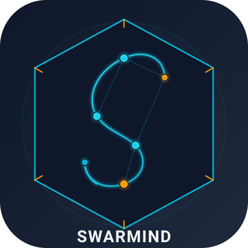

# Swarmind — Multi-Agent Harness (English summary)

**Swarmind** is a Python harness for coordinating AI coding agents (OpenCode,
Claude Code, Codex) with governed fan-out, model routing, portable memory,
token economics and evidence-driven validation.

> The Spanish documentation is the primary source. This English book is a
> navigation summary; the full README lives at the repository root.

## At a glance

| | |
|---|---|
| Agents | **26** specialist subagents + coordinator |
| Skills | **49** with contracts, `SKILL.min.md` and registry digests |
| Tests | **7.7k+** in the local TDD suite |
| Engine | Python 3.12+, hexagonal packages by domain |
| Memory | LanceDB (optional) + SQLite-vec + federated search |
| License | MIT |

## Start here

- [Repository README](https://github.com/MauricioFCC/SWARMIND/blob/main/README.md)
- [Documentation hub](https://github.com/MauricioFCC/SWARMIND/blob/main/docs/README.md)
- [Spanish documentation (primary)](https://github.com/MauricioFCC/SWARMIND/blob/main/docs/src/es/README.md)
- [Roadmap and current state](https://github.com/MauricioFCC/SWARMIND/blob/main/docs/src/es/roadmap/estado.md)
- [Agents index](https://github.com/MauricioFCC/SWARMIND/blob/main/docs/src/es/agents/INDEX.md)
- [Skills index](https://github.com/MauricioFCC/SWARMIND/blob/main/docs/src/es/skills/INDEX.md)

## Scope and limits

Swarmind is not an OS sandbox: agents run with your permissions. Legal, medical
and safety-critical outputs are drafts that require human review.
