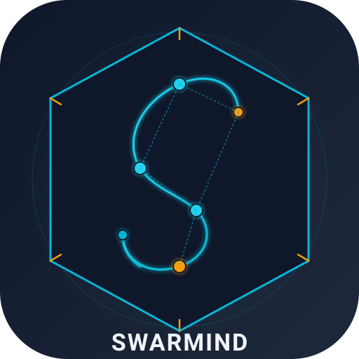

# Swarmind



**Harness en Python para coordinar agentes de código (OpenCode, Claude Code,
Codex) con un solo motor modular:** fan-out gobernado, routing de modelos,
memoria portable, economía de tokens y validación que produce evidencia.

> Documentación primaria en español. Para GitHub, el [README raíz](https://github.com/MauricioFCC/SWARMIND/blob/main/README.md)
> está en inglés y el [hub de docs](https://github.com/MauricioFCC/SWARMIND/blob/main/docs/README.md) mapea las cuatro categorías
> de [Diátaxis](https://diataxis.fr/).

## Estado en una vista

| | |
|---|---|
| Agentes | **26** subagentes especializados + coordinador |
| Skills | **49** con contrato, `SKILL.min.md` y digest |
| Tests | **7.7k+** en la suite local (TDD + PBT + mutación) |
| Motor | Python 3.12+, hexagonal, paquetes por dominio |
| Memoria | LanceDB (opcional) + SQLite-vec + búsqueda federada |
| Propagación | solo `~/.config/opencode` (sin copias por proyecto) |

El detalle de estado, hitos y deuda está en
[Estado del Proyecto](roadmap/estado.md).

## Empieza aquí

```bash
git clone https://github.com/MauricioFCC/SWARMIND.git
cd SWARMIND
python scripts/install.py      # Windows/Linux/macOS; sin PowerShell
uv run python -m pytest harness/tests/ -q
python -m harness              # menú interactivo
```

Delegación directa:

```bash
python harness/run.py "@builder: implementa una API REST con tests"
python harness/run.py "investiga papers sobre transformers 2026"
```

Comandos: `!health`, `!metrics`, `!skill list`, `!session`, `!reset`, `!help`.
Tutorial completo: [Cómo usar Swarmind](guide/como-usar.md).

## Mapa de documentación

| Necesidad | Empieza por |
|---|---|
| **Tutorial** | [Cómo usar Swarmind](guide/como-usar.md) |
| **How-to** | [Estándares](guide/estandares.md) · [SSOT global](guide/opcion-a-ssot-global.md) · [Velocidad](guide/velocidad.md) |
| **Referencia** | [Agentes](agents/INDEX.md) · [Skills](skills/INDEX.md) · [API](api/) · [Specs](https://github.com/MauricioFCC/SWARMIND/tree/main/docs/specs) |
| **Explicación** | [Arquitectura Swiss Watch](architecture/swiss-watch.md) · [Composición](architecture/composicion.md) · [Filosofía](guide/filosofia.md) |

## Calidad y evidencia

- Gates locales: ruff, vulture, arquitectura + ratchet, complejidad N/2N/4N,
  ruff-ratchet, preview, PEP 649, skills y enlaces/índices de docs.
- `scripts/publish.py`: push + propagación **solo** al global + verificación de
  drift.
- Los índices de agentes/skills se generan desde `.opencode/`; no se editan a
  mano.

## Límites

- No es un sandbox del sistema operativo: los agentes usan tus permisos.
- Salidas legales/médicas son borradores con revisión humana obligatoria.
- El sitio mdBook en inglés es un resumen; el español es la fuente primaria.
